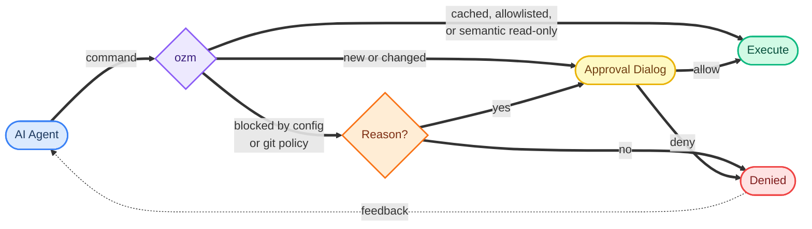

# ozm

ozm - Oberzugriffsmeister ("chief access master") - is a command gate for AI coding agents. It lets agents run useful shell, script, and git commands while risky work still passes through human-owned policy or review.

Most agent setups force a bad choice: babysit every command, or trust the agent blindly. `ozm` gives you a third option. It sits between the agent and your shell, checks command intent and content, and remembers approvals per project so repeated safe work can flow.

- **Hash-gated script review**: scripts run through `ozm run`, are reviewed by content hash, and show diffs when they change.
- **Command approval and caching**: arbitrary argv-style commands run through `ozm cmd`, with exact command approvals cached per project.
- **Global and per-project rules**: allowlist safe command patterns, block dangerous ones, and keep trusted project config outside the repo.
- **Agent work context**: every `ozm run`, `ozm cmd`, and `ozm git` call must include `--agent-name` and `--agent-description`, so approval dialogs show what the agent is trying to do.
- **Native macOS dialogs**: approvals include syntax highlighting, dark mode support, an Ozm in-memory file indicator for generated content, editable commands, rule creation, global/project scope, and inline feedback for the agent.
- **One-time overrides**: blocked config matches and git policy violations can be escalated with `--reason` for explicit user approval without changing caches or allowlists.
- **Git guardrails**: commit message limits, optional attribution and branch rules, no force pushes, no main/master pushes, and dangerous git config/subcommands are blocked.
- **Codex and Claude Code enforcement**: install hooks route direct shell work through `ozm` and write agent instructions for the project.
- **Audit and diagnostics**: `ozm log`, `ozm status`, `ozm config`, and `ozm doctor` expose what happened and how the install is configured.



## Screenshots

> Screenshot placeholder: command approval dialog (`docs/screenshots/command-approval.png`)
>
> Show agent name, agent description, editable command, allow/block rule pattern, Apply globally, and feedback field.

> Screenshot placeholder: changed script diff review (`docs/screenshots/script-diff.png`)
>
> Show a changed script with syntax-highlighted unified diff and approval buttons.

> Screenshot placeholder: diagnostics and status (`docs/screenshots/doctor-status.png`)
>
> Show `ozm doctor`, `ozm config`, and `ozm status` output in a terminal.

## Install

```bash
# via Homebrew
brew tap kamyar/ozm https://github.com/kamyar/ozm
brew install ozm

# or via uv
uv tool install ozm

# or via pip
pip install ozm
```

## Quick start

```bash
cd your-project
ozm install --project
ozm doctor
```

`ozm install --project` installs the Claude Code and Codex hooks, then writes or appends `CLAUDE.md` and `AGENTS.md` instructions in the project. Restart Codex after installing so new sessions load the hook and execpolicy configuration.

Configuration is optional. Without config, unknown commands and new or changed scripts go through the approval dialog. To pre-approve common safe commands or block known dangerous ones, create `.ozm.yaml`, run `ozm trust`, and use `ozm config` to see where the trusted copy lives.

## Hands-free mode

Start the menu bar app with `ozm app start`. Open its menu and turn on **Hands-free** to approve all pending and new approval requests without review. This includes commands, scripts, and one-time override requests in every project. A small blue dot beside the menu bar shield shows that the mode is on.

Policy blocks and input validation remain active. Blocked operations still need `--reason` where an override is supported. Hands-free mode takes priority over DND. Hands-free and DND settings are saved on this Mac and restored after app and computer restarts. Both default to off on first use. There is no CLI or repository option to enable hands-free mode.

Automatic approvals do not add cache entries, script snapshots, or allowlist rules. Existing approvals remain unchanged. Turn the toggle off to restore normal review. Use `ozm app status` to check the mode and `ozm log --summary` to count hands-free approvals separately from manual approvals.

> **Warning:** All approval requests are accepted while this mode is on, including destructive operations that reach an override request. If you leave it on, it stays on after a restart. Enable it only when you accept this risk. Update both the CLI and the app before use.

## Agent compatibility

ozm works with any AI coding agent that executes shell commands:

- **Claude Code**: hooks into the `PreToolUse` system via `~/.claude/settings.json`.
- **Codex / OpenAI agents**: enables Codex hooks in `~/.codex/config.toml`, installs additive execpolicy rules in `~/.codex/rules/ozm-enforcement.rules`, and writes `AGENTS.md` for project-level instructions.
- **Other agents**: any agent that follows instructions in `CLAUDE.md` or `AGENTS.md` can route commands through ozm.

For Claude Code and Codex, enforcement is automatic via hooks and policy. For other agents, compliance depends on the agent following the project instructions.

## Safety model

### Scripts: `ozm run`

Use `ozm run` for scripts, not `python script.py`, `bash script.sh`, `uv run`, or `./script.sh` directly.

```bash
ozm run --agent-name "Run tests" --agent-description "Execute the reviewed test script." ./scripts/test.sh
```

Scripts must have a shebang, but the source file does not need an executable file mode. Do not run `chmod +x` before `ozm run`; ozm executes the reviewed content from a private, user-executable snapshot. Ozm rejects scripts with only one executable line before cache or approval checks. It also rejects disk, stdin, and generated in-memory shell files when every command segment is an `ozm` invocation. Run those Ozm commands directly and one at a time so normal automatic approvals can apply. This also applies to environment-prefixed wrappers such as `PATH=/path/to/venv/bin:$PATH ozm run tool.py`. For tools with a dedicated environment, install a complete local script with a fixed interpreter shebang and run that file through `ozm run`. Run other single commands directly with `ozm cmd`, `ozm gh`, or `ozm git`; use `ozm bash --command` only when shell syntax is required. Generated one-line commands without shell operators, substitutions, expansions, or redirections are redirected to their direct Ozm family before approval. The first approval stores the script's SHA-256 hash under the current project. Unchanged scripts run without prompting. Changed persistent files show a diff against their last approved snapshot. Generated stdin and shell content always shows a complete review because reused generated titles do not prove that two snippets are related. Shell snippets use command presentation instead of file presentation.

### Shell-free location and output controls

Put root options before the command family. Ozm rejects misplaced root controls before approval and shows the correct placement. Use `--cwd DIRECTORY` instead of a shell `cd` wrapper. Repeat `--grep TERM` to show stdout lines that contain any selected literal term. Use `--head N` or `--tail N` to select leading or trailing filtered lines:

```bash
ozm --cwd /path/to/worktree --grep "projection" --grep "coverage" --head 20 git --agent-name "Inspect main" --agent-description "Find projection and coverage code on main." show origin/main:path/to/config.go
```

The controls work with `ozm cmd`, `ozm gh`, `ozm git`, and `ozm run`. Ozm applies `--cwd` before project policy. It applies `--grep` before `--head` or `--tail`. Ozm leaves stderr unchanged, continues consuming stdout until the child finishes, and preserves the child exit code even when grep finds no line. Use these options instead of creating a shell pipeline with `grep`, `rg`, `head`, or `tail` only to filter output. Ozm nudges generated commands that end in `|| true`, rejects raw or Ozm shell pipelines that end in a supported `head` form, and blocks Ozm pipelines to `true` because they discard output and can interrupt execution. Generated wrappers made only of separate simple commands must run each command directly. Generated wrappers must not invoke or source mutable scripts because the dialog would review the wrapper instead of the target script content.

### Tools that return result file paths

Run the tool directly. After it succeeds, read or filter the exact returned file in a separate call. Do not use `RESULT=$(...) && jq ... "$RESULT"` only to connect these steps. Do not reuse a result path from an earlier call. Separate calls retain normal command policy; this guidance does not approve shell substitutions.

### Commands: `ozm cmd`

Use `ozm cmd` for non-script commands.

```bash
ozm cmd --agent-name "Install deps" --agent-description "Install project dependencies." uv pip install -e .
ozm cmd --agent-name "Check API" --agent-description "Call the service health endpoint." curl https://api.example.com/health
```

Conservative built-in reads such as `command -v`, `bazel query`, `brew search`, `npm view`, and `npm list` run without command approval or cache checks. Exact metadata, help, and disk-usage forms for trusted Pi, Bazel, Go, Docker, OrbStack, and system tools also run as semantic reads from trusted executable paths. Trusted `cmp FILE_A FILE_B` and `shasum -a 256 FILE...` forms run without approval. Operands must be non-empty file names that do not start with `-`; use a path such as `./-file` for such names. Unknown options and stdin forms retain normal policy. Child exit codes are unchanged, including differences and missing-file errors. Write-capable and unknown forms retain normal policy. `ozm cmd` executes argv directly rather than through a shell. It detects direct, interpreter, and wrapper-based script execution, preserves script arguments in the `ozm run` nudge, applies enabled private entry-point redirects before policy or cache checks, refuses `ozm cmd git ...` in favor of `ozm git`, refuses direct `gh` or `ozm cmd gh ...` usage in favor of `ozm gh`, and hard-blocks cases that are unsafe to blanket approve, including `sed`, `gsed`, and `rg --pre`. When `chmod` targets a file modified in the last 10 minutes, Ozm requires `--confirm-recent-chmod` before normal command policy checks continue. Bare `env` output is blocked because it can expose secrets. Executables under temporary locations bypass config and cache; they require a reasoned one-time override, display their SHA-256 digest, and are rechecked after approval.

Use `ozm gh` for GitHub operations. It applies the normal blocklist, allowlist, cache, and approval flow, then resolves `gh` from trusted system locations. Use typed `ozm gh pr review-reply` and `ozm gh issue add-sub-issue` operations for fixed repository writes. Use `ozm gh issue create-batch --repo OWNER/REPOSITORY --manifest FILE` to review multiple issue creations once without adding persistent write authorization; Ozm rejects equivalent raw REST POST requests and prints typed replacements. Exact repositories can authorize these operations under `github.allowed_operations`. Known high-level reads and unambiguous REST `GET` and `HEAD` requests can run without an approval dialog. If `-f` or `-F` would make a proven GET-only REST endpoint default to POST, Ozm stops before approval and prints an explicit `--method GET` replacement. REST writes, ambiguous methods, file-backed input, unsafe method-override headers, and absolute non-GitHub endpoints still require review. GraphQL requests such as `gh api graphql -f query=...` are auto-allowed only when the selected operation is definitely a query. Mutations, file-backed queries, malformed documents, or ambiguous multi-operation requests still require review.

### Git: `ozm git`

Use `ozm git` for git operations.

```bash
ozm git --agent-name "Commit fix" --agent-description "Create a short commit for the config fix." commit -m "Fix config loading"
ozm git --agent-name "Inspect status" --agent-description "Check the current git state." status
```

All git subcommands pass through, but policy checks apply to commits, pushes, dangerous history-rewrite commands, and dangerous config keys. Commit messages must use one single-line `-m "message"` with a 72-character subject limit and 500-character total limit. Commit-message shape errors cannot be overridden. Broad force pushes are blocked without a dialog. Only full `--force-with-lease=REF:EXPECTED_SHA` options can request a one-time override. An atomic multi-ref rewrite can supply one exact lease for each forced ref. Pushes to `main` or `master` remain override-gated.

For an override-eligible operation, add `--reason "..."` to request a one-time override:

```bash
ozm git --agent-name "Ship hotfix" --agent-description "Push the production fix branch." push --reason "Emergency release approved by the user."
ozm cmd --agent-name "Clean build" --agent-description "Remove generated build artifacts." rm -rf build/ --reason "Clear stale generated output before rebuilding."
```

Approved overrides run once, are logged, and are not cached or converted into allowlist rules.

## Commands

```text
$ ozm --help

Commands:
  cmd      Run an arbitrary command after approval.
  config   Show the path to this project's user-owned config.
  doctor   Check ozm installation health.
  gh       Operation-aware GitHub CLI proxy.
  git      Git pass-through.
  install  Install ozm hooks system-wide.
  log      Show recent audit log entries.
  reset    Forget approval for a script (or all scripts with --all).
  run      Run a script after content review (hash-gated).
  status   Show tracked files and commands with their approval status.
  trust    Snapshot the in-repo .ozm.yaml into ~/.ozm/projects/.
  version  Show ozm version.
```

See [docs/commands.md](docs/commands.md) for detailed usage and examples.

## Configuration

Configuration is optional. Without it, every new command or changed script goes through the approval dialog or project-scoped hash cache. To pre-approve safe commands, create `.ozm.yaml` in your project root:

```yaml
allowed_commands:
  - pytest
  - "gh issue view"
  - "gh pr view"
  - "uv pip install *"
  - "docker compose *"

blocked_commands:
  - "rm -rf *"
  - "curl * | sh"

commit:
  allow_attribution: false
  require_branch: false
  branch_prefixes: []
```

Then run `ozm trust` to activate it. This copies `.ozm.yaml` into `~/.ozm/projects/`, where ozm actually reads it. The in-repo file is never read at runtime, so agents can edit it freely but changes have no effect until a human explicitly trusts them.

Use `ozm config` to print the current project root, trusted project config path, global config path, and whether the trusted project config exists.

For commands you want available in every project, add `allowed_commands` or `blocked_commands` to `~/.ozm/config.yaml`, or check **Apply globally** when saving a rule from the command approval dialog. If the rule field is blank, ozm saves the exact command globally. Global and project blocklists are evaluated before any allowlist.

> **Security note:** Avoid patterns like `"uv run *"`, `"python *"`, or `"uv *"` in `allowed_commands`; these bypass content review for script files. Use `ozm run` for scripts instead. `sed`, `gsed`, and `rg --pre` are never allowlisted because they can execute or edit content outside the reviewed script path.

See [docs/configuration.md](docs/configuration.md) for all options.

### Private tools and policies

Keep employer-private tools, repository names, endpoints, symbols, and policies out of Ozm's public source, tests, examples, and generated instruction templates. Put private command routing in data-only rule packs under `~/.ozm/rule-packs/`. Enable packs explicitly from user-owned Ozm configuration. Keep repository-specific authorization in `~/.ozm/config.yaml` or `~/.ozm/projects/`.

Ozm does not load rule packs from a repository. A malformed or missing enabled pack stops the command. Rule-pack redirects only block wrappers and suggest a configured installed entry point. They do not authorize the target command. A redirect can use `target_family: run` with an absolute installed script path to preserve content review and hash caching. Python script and `uv run --with PACKAGE script.py` wrappers receive the same redirect before approval.

## How it works

1. `ozm install` writes the enforcement hook and configures Claude Code and Codex to use it.
2. The hook rejects direct risky command families and tells the agent to use `ozm run`, `ozm cmd`, or `ozm git`.
3. `ozm run`, `ozm cmd`, and `ozm git` reject missing, empty, multiline, or malformed agent metadata before execution. Missing metadata receives the memory reminder. Invalid metadata receives a specific repair instruction. The name limit remains 80 characters and the description limit remains 200 characters.
4. Commands are checked against hard safety rules, project/global blocklists, semantic read-only rules, project/global allowlists, and the project-scoped approval cache.
5. Unknown commands and new or changed scripts open a native macOS approval dialog.
6. Approved script contents and exact commands are stored per project in `~/.ozm/hashes.yaml`; changed script snapshots live under `~/.ozm/snapshots/`.
7. Every recorded decision is appended to `~/.ozm/audit.log`. New records retain the text fields and add a versioned, tab-delimited JSON suffix. It records agent identity, decision reason, matched rule identifier, and script digest when applicable. It does not copy agent descriptions or command arguments into these new fields. Metadata failures record only a category and `<metadata>`, not input values. Old records remain readable. Use `ozm log --summary --since 3h` to separate manual approvals, denials, policy blocks, validation failures, and script approvals. Generated shell descriptions include nested command families where the static parser can identify them. Unsupported grammar is `unknown`; audit classification never grants permission. Log output reports the selected UTC window and entry limit. JSON output includes a `selection` object.

On macOS, approvals use native Cocoa dialogs with syntax highlighting via Pygments, dark mode support, agent work context, editable command fields, and inline feedback. Without a GUI session, unknown commands and new or changed scripts are blocked rather than silently approved.

## Requirements

- Python 3.12+
- macOS with a GUI session for new approvals
- Pygments for syntax highlighting (installed by the package dependencies)
